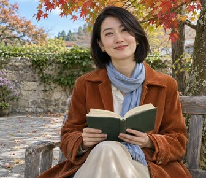
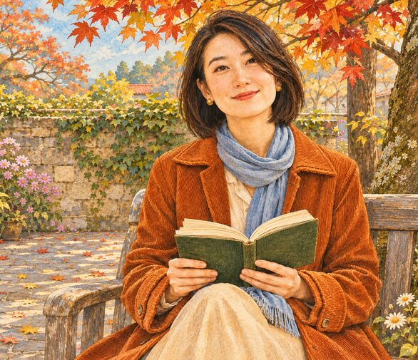
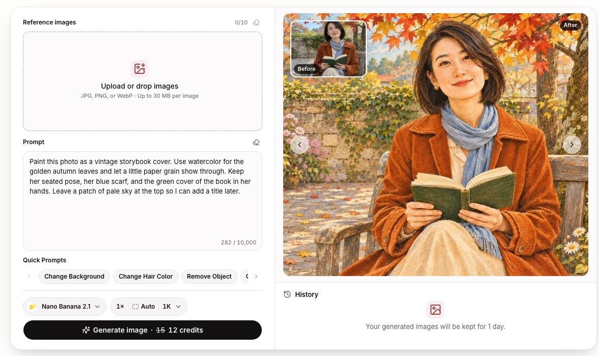
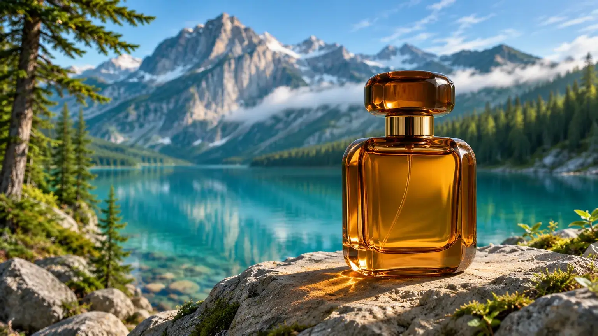

# AI Img2Img User Guide

[Visit the AI Img2Img website](https://aiimg2img.net/) · English · [简体中文](README.md)

Look at the two images below. In both, a woman in a blue scarf sits on a garden bench with a green book open in her hands. In the second, the autumn leaves are brushstrokes and the paper grain shows through her coat. With AI Img2Img, you can use a photo you already like as the starting point for an edit like this. Drop it into your browser and describe what should change and which details you want to keep.

| Original photo | AI Img2Img storybook example |
| :---: | :---: |
|  |  |

Try turning this portrait into a book cover, then use the same approach to give a product a new setting or soften a crease in an old family photo. [Open the AI Img2Img editor](https://aiimg2img.net/#image-workspace)

## Make a storybook cover from a photo

**1. Pick a reference photo.** To follow along, save the practice photo to your device. If you use your own portrait, choose one where the face, hands, and anything the person is holding are clearly visible. Drop the file into **Reference images**, or click the upload area to select it. The editor lists the file types and size limit for the current model. [Get the practice photo](assets/storybook-before.jpg)

**2. Tell the editor what makes the photo yours.** Paste the text below into **Prompt**. If you're using a different photo, replace the scarf and book with details you would recognize in any version of it.

> Paint this photo as a vintage storybook cover. Use watercolor for the golden autumn leaves and let a little paper grain show through. Keep her seated pose, her blue scarf, and the green cover of the book in her hands. Leave a patch of pale sky at the top so I can add a title later.

**3. Choose a cover shape and generate an image.** Start with the current model. For an upright cover, open the generation settings and choose a portrait aspect ratio, such as 3:4, if available. Check the credit cost on **Generate image**, then click it. You can try the editor without signing in using the daily free allowance.

**4. Check the details and download your cover.** Open the result and look at how her fingers meet the book. Is the spine still straight? Would your title fit above her head? If you like the illustration but the leaves fill that space, keep the same reference photo and change just the final sentence to “Leave the top quarter of the cover open, with a pale cream sky.” Generate another version and download your favorite. If you're signed in, you can revisit recent work in **History**.

To see what a different model brings to the picture, keep the photo and prompt the same and try Nano Banana, GPT Image, or Seedream. Compare the texture of the paper and the expression on her face. Check the available aspect ratios, number of images, and credit cost each time you switch models.

## Give a product photo a new setting

Suppose you're making a summer poster for a perfume. One photo shows the amber bottle you want to feature. Another has the blue-green lake you want behind it. Choose a model that accepts multiple reference images. Upload the bottle first and the lake second, then refer to them in the prompt by their upload order.

> Place the amber perfume bottle from `@image_1` on a rock beside the lake. Keep the bottle’s proportions, the shape of its cap, and the color of the glass. Use the blue-green water and distant mountains from `@image_2` for the background. Let sunlight pass through the glass from behind and to one side, casting a small patch of amber light on the stone.

Use the two practice images to try it yourself. Compare the finished bottle with the product photo, especially the outline of the cap and the width of the bottle. If your own product has a label, check its lettering before using the image in a listing. [Image 1 · Perfume bottle](assets/perfume.webp) · [Image 2 · Mountain lake](assets/lake.webp)

## Try a prompt with your own photos

| If you have… | Try this prompt |
| --- | --- |
| A creased black-and-white family photo | Soften the white crease down the center. Keep the photo black and white, and preserve the fine lines around the eyes and the texture of the clothing. |
| A photo of a mug on a table | Replace the tabletop with pale gray stone. Keep the color of the glaze, the direction of the handle, and the shadow under the mug. Add soft light from the left. |
| A travel photo of a bay | Turn the bay into a miniature scene inside an open wooden box. Keep the arch of the stone bridge, the position of the red roofs, and the color of the water. |

For more ideas, pick an image in **Get inspired** and click **Use prompt**. This replaces the text in the prompt field and keeps your reference images in place. Swap in details from your own photo before you generate. [Browse the examples and try their prompts](https://aiimg2img.net/#inspiration)
