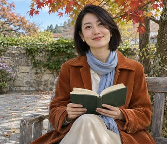
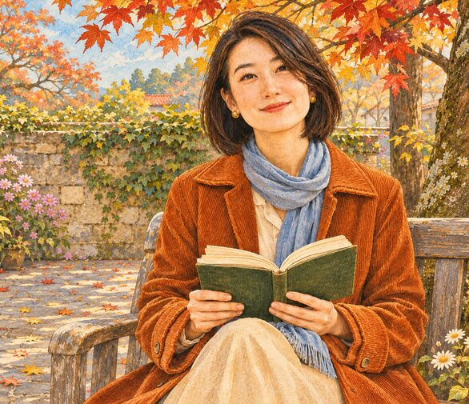
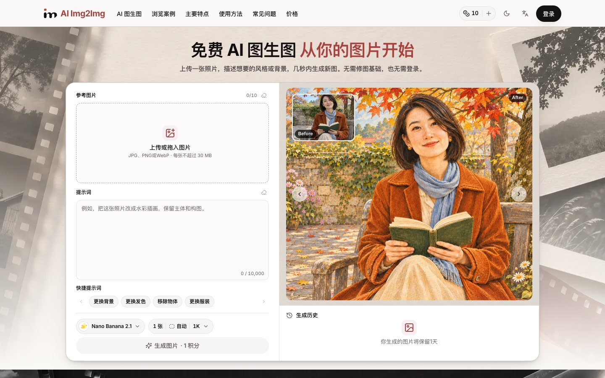

# AI Img2Img 在线图生图使用指南

[访问 AI Img2Img 官网](https://aiimg2img.net/) · 简体中文 · [English](README.en.md)

秋天拍的一张读书照，很适合做成送给朋友的绘本封面。你可能想留下她手里的绿皮书、绕在颈间的蓝围巾，还有树叶透过阳光的颜色。用 AI Img2Img，只要把照片拖进浏览器，再用一句话说明想把它画成什么样，就能从这张原图开始尝试。

| 原始照片 | 官网的复古童书插画示例 |
| :---: | :---: |
|  |  |

这就是「图生图」。照片提供人物、物件和构图，你用文字指定要改的部分。同样的方法也适合给商品换个拍摄场景，或淡化老照片上的折痕。[打开 AI Img2Img 中文工作区](https://aiimg2img.net/zh#image-workspace)

## 跟着做一张绘本封面

**1. 准备照片。** 可以先把上面的原始照片保存到本地，跟着做一遍。换自己的照片时，选一张脸部清楚、手和书都在画面里的。把文件拖进工作区的「参考图片」，或点击上传。上传框会列出当前模型接受的格式和每张图片的大小上限。[打开练习原图](assets/storybook-before.jpg)

**2. 写下你希望画师看到的细节。** 把下面这段话粘贴到「提示词」。如果用自己的照片，把围巾、书和树叶换成照片里最有辨识度的东西。

> 把照片画成一本旧童书的封面，用水彩画出橙黄的秋叶，纸面留一点颗粒感。保留她捧书的坐姿、蓝围巾和绿色书皮。画面上方留一小块浅色空白，方便我以后加书名。

**3. 选画幅，生成一张。** 第一次可以沿用当前模型。想做竖版封面，就在生成参数里选一个可用的竖向比例，例如 3:4。先看「生成图片」按钮上显示的积分，再点生成。网站提供每日免费额度，游客也能试用。

**4. 放大看，再下载。** 打开生成结果，对照原图看看手指握书的位置、书脊的方向，以及上方的空白够不够放标题。如果画风合适，但树叶占满了封面，就把提示词的最后一句改成「上方四分之一留出浅米色天空」，用同一张原图再试一版。挑中喜欢的版本后，点下载按钮保存。登录用户也可以回到「生成历史」查看近期作品。

好奇换个模型会画成什么样？保留这张照片和提示词，在工作区切换 Nano Banana、GPT Image 或 Seedream，就能比较各自画出的纸张纹理和人物神态。换模型后，看一眼画幅、出图张数和积分，它们会随所选模型与设置而变。

## 两张参考图也能一起用

假设你在给一瓶香水做夏季海报。你喜欢产品照里的琥珀色玻璃，也喜欢另一张风景照里的蓝绿色湖水。选一个支持多张参考图的模型，先上传香水瓶，再上传山湖照片。输入提示词时，用 `@image_1` 和 `@image_2` 分别指代它们。

> 把 `@image_1` 的琥珀色香水瓶放在湖边岩石上，保留瓶身比例、瓶盖形状和玻璃颜色。背景参考 `@image_2` 的蓝绿色湖水和远山。阳光从侧后方穿过玻璃，让瓶底在石面上投出一小片琥珀色的光。

想跟着试，可以保存这两张参考图。成图后，先对照产品照检查瓶盖轮廓和瓶身比例。如果自己的商品带标签，再逐字核对上面的文字。[图 1 · 香水瓶](assets/perfume.webp) · [图 2 · 山湖](assets/lake.webp)

## 换成自己的照片，可以这样写

| 手头的照片 | 可以直接改写的提示词 |
| --- | --- |
| 有折痕的黑白合照 | 淡化照片中央的白色折痕，保留黑白色调、眼角的细纹和衣服上的纹理。 |
| 在桌面上拍的商品照 | 把桌面换成浅灰色石台，保留杯子的釉色、杯柄朝向和杯底阴影，让柔光从左边照进来。 |
| 旅行时拍的海湾 | 把海湾做成打开的木盒里的微缩模型。保留岸边石桥的拱形、红屋顶的位置和海水的颜色。 |

写到一半没想法，可以到官网的「寻找创作灵感」挑一张接近目标的图。点「使用提示词」，示例文字会替换输入框里的内容，已经选好的参考图会保留。再把里面的主体和细节换成你自己的，就能接着试。[浏览官网案例与提示词](https://aiimg2img.net/zh#inspiration)
